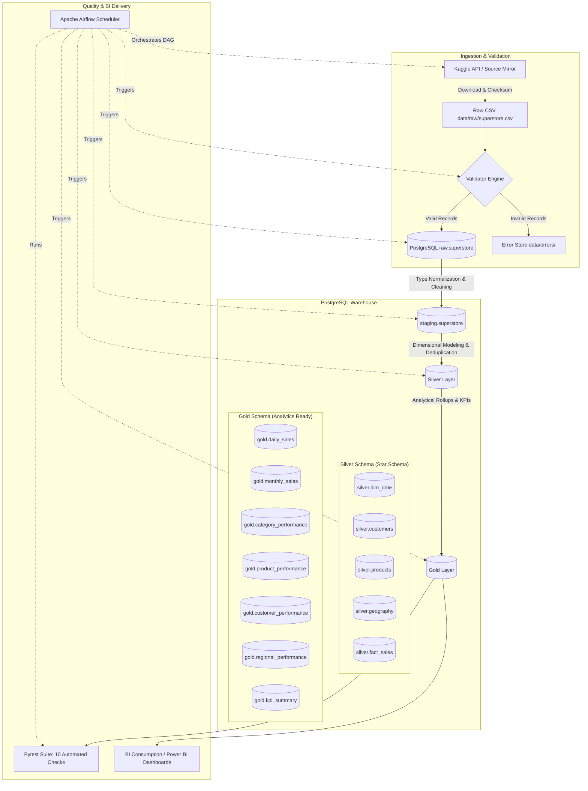

# End-to-End Superstore Sales Data Pipeline

A production-style, reproducible data engineering pipeline built using Python, PostgreSQL, SQL, and Apache Airflow.

---

## 1. Project Overview

This repository implements an end-to-end data pipeline processing the canonical **Superstore Sales dataset** (9,994 transaction records). It demonstrates foundational data engineering practices:

- Automated ingestion with Kaggle API integration and reliable fallback handling.
- Deterministic data validation preventing corrupted records from entering downstream stores.
- Multi-tier data warehouse architecture in PostgreSQL (`raw`, `staging`, `silver`, `gold`).
- Dimensional modeling (Star Schema) and analytical aggregations ready for Power BI / Tableau.
- Automated data quality testing using Pytest.
- Full workflow orchestration using Apache Airflow.
- Strict idempotency guarantees across all pipeline stages.

---

## 2. Architecture



---

## 3. Technologies & Technical Rationale

| Technology | Purpose | Rationale |
|---|---|---|
| **Python 3.11+ / uv** | Core Programming & Package Management | High execution performance, fast virtual environment resolution, and readable scripting. |
| **PostgreSQL 15** | Relational Analytical Warehouse | Industry-standard relational database with strong ACID guarantees, robust schemas, and window function support. |
| **SQL** | Transformations & Business Modeling | Declarative, database-native data processing maximizes performance and clarity. |
| **Pandas** | Ingestion & Verification | Flexible handling of CSV parsing, encoding (`windows-1252`), and metadata validation. |
| **Pytest** | Automated Quality Verification | Simple, extensible test runner for checking schema constraints, record counts, and KPI consistency. |
| **Apache Airflow 2.8+** | Orchestration & Scheduling | Production-grade DAG dependency management, automated retries, and execution monitoring. |
| **Docker Compose** | Infrastructure Management | Reproducible, containerized deployment of PostgreSQL and Airflow without host dependency conflicts. |

---

## 4. Repository Structure

```text
pipeline/
├── data/
│   ├── raw/                  # Original unmodified CSV and ingestion metadata
│   ├── processed/            # Cleaned CSV outputs if persisted locally
│   └── errors/               # Quarantine directory for rejected/invalid records
├── src/
│   ├── ingestion/            # Kaggle API downloader and metadata tracking
│   ├── validation/           # Schema, domain, and data-type validation engine
│   ├── transformation/       # Coordination of SQL transformations
│   ├── loading/              # Database connectivity and raw CSV loader
│   └── utils/                # Configuration and structured logging
├── sql/
│   ├── staging/              # DDL and load scripts for staging.superstore
│   ├── silver/               # DDL and load scripts for dimensional entities
│   └── gold/                 # DDL and load scripts for analytical rollups & KPIs
├── dags/
│   └── superstore_pipeline_dag.py  # Airflow DAG orchestrating all tasks
├── tests/
│   ├── test_validation.py          # Unit tests for data validator & error handling
│   └── test_database_pipeline.py   # Warehouse integration & business logic tests
├── notebooks/
│   └── 01_exploration.ipynb        # Exploratory Data Analysis (EDA) notebook
├── docs/
│   └── dashboard.md                # Power BI modeling guide and dashboard layouts
├── scripts/
│   ├── init_db.sql                 # PostgreSQL container initialization script
│   └── run_pipeline.py             # CLI runner for the end-to-end pipeline
├── .env.example                    # Environment variable template
├── .gitignore                      # Git exclusion rules
├── docker-compose.yml              # Container definitions (PostgreSQL + Airflow)
├── pipeline.py                     # Root entrypoint shortcut
├── pytest.ini                      # Pytest discovery settings
├── requirements.txt                # Python project dependencies
└── README.md                       # Complete documentation
```

---

## 5. Configuration & Environment Variables

Copy `.env.example` to `.env`:

```bash
cp .env.example .env
```

| Variable | Default Value | Description |
|---|---|---|
| `POSTGRES_HOST` | `localhost` | Host machine address for PostgreSQL. |
| `POSTGRES_PORT` | `5433` | Host port mapped to PostgreSQL (avoids default 5432 conflict). |
| `POSTGRES_DB` | `superstore` | Analytical database name. |
| `POSTGRES_USER` | `postgres` | Database superuser. |
| `POSTGRES_PASSWORD` | `postgres` | Database password. |
| `KAGGLE_USERNAME` | *(Optional)* | Your Kaggle username for programmatic downloads. |
| `KAGGLE_KEY` | *(Optional)* | Your Kaggle API key token. |
| `KAGGLE_DATASET` | `vivek468/superstore-dataset-final` | Target Kaggle dataset slug (9,994 rows with Profit/Quantity). |
| `RAW_DATA_PATH` | `data/raw/superstore.csv` | File location for source CSV. |
| `ERROR_DATA_PATH` | `data/errors/superstore_invalid.csv` | File location for quarantined records. |

> **Note on Kaggle Authentication:** If you do not provide Kaggle API credentials, the pipeline automatically uses the verified local cache or falls back to the canonical public mirror, ensuring zero-configuration execution.

---

## 6. Installation & Quickstart

### Prerequisites
- Python 3.11+ (or `uv`)
- Docker Desktop installed and running

### Step 1: Clone and Set Up Python Environment
```bash
# Using uv (fastest)
uv venv
.venv\Scripts\activate   # On Windows
# source .venv/bin/activate  # On Linux/macOS
uv pip install -r requirements.txt
```

### Step 2: Start PostgreSQL with Docker Compose
```bash
docker compose up -d postgres
```

Verify that the container is healthy:
```bash
docker ps --filter "name=superstore_postgres"
```

### Step 3: Run the Complete Pipeline
Execute the complete workflow from the CLI:
```bash
python pipeline.py
```

Expected output:
```text
INFO Starting Superstore End-to-End Data Pipeline
INFO Step 1/6: Ingesting dataset...
INFO Step 2/6: Validating raw data...
INFO Step 3/6: Loading raw data into PostgreSQL raw.superstore...
INFO Step 4/6: Standardizing data in staging.superstore...
INFO Step 5/6: Building Silver dimensional model...
INFO Step 6/6: Generating Gold analytical datasets and KPIs...
INFO Running automated data quality tests...
10 passed in 0.52s
INFO Pipeline executed successfully and idempotently!
```

---

## 7. Database Layers & Data Dictionary

### Layer 1: `raw`
- **Table**: `raw.superstore` (9,994 rows)
- **Role**: Preserves the original file structure and column names verbatim. No business transformations are applied here.

### Layer 2: `staging`
- **Table**: `staging.superstore` (9,994 rows)
- **Role**: Normalizes column names to `snake_case`, standardizes string casing and whitespace with `TRIM()`, formats US postal codes to 5-digit strings, and casts dates (`MM/DD/YYYY` to `DATE`).

### Layer 3: `silver` (Star Schema)
- **`silver.customers`** (793 rows): Deduplicated customer master table (`customer_id`, `customer_name`, `segment`).
- **`silver.products`** (1,862 rows): Deduplicated product master table (`product_id`, `product_name`, `category`, `sub_category`). Resolves name variations using frequency ranking.
- **`silver.geography`** (632 rows): Unique geographical hierarchies (`location_id`, `country`, `region`, `state`, `city`, `postal_code`).
- **`silver.dim_date`** (2,922 days): Calendar date dimension covering years 2013 through 2020.
- **`silver.fact_sales`** (9,994 rows): Order line item fact table with foreign keys to all dimensions, line profit margin, shipping duration (`days_to_ship`), and profitability flag (`is_profitable`).

### Layer 4: `gold` (Analytical Mart)
- **`gold.daily_sales`** (1,237 rows): Daily revenue, profit, orders, and average order value (AOV).
- **`gold.monthly_sales`** (48 rows): Monthly aggregations across 4 full years (2014–2017).
- **`gold.category_performance`** (17 rows): Category and sub-category sales, profits, margins, and loss-order counts.
- **`gold.product_performance`** (1,862 rows): Individual product metrics with sales/profit ranks and loss-maker flags.
- **`gold.customer_performance`** (793 rows): Customer lifetime value, order frequency, and tenure dates.
- **`gold.regional_performance`** (49 rows): State-level performance metrics.
- **`gold.kpi_summary`** (7 key metrics): Executive scorecard values.

---

## 8. Business Metrics & Verified KPIs

| Metric | Value | Definition / Calculation |
|---|---|---|
| **Total Gross Sales** | **$2,297,200.86** | `SUM(sales)` across all transactions |
| **Total Net Profit** | **$286,397.02** | `SUM(profit)` across all transactions |
| **Total Orders** | **5,009** | `COUNT(DISTINCT order_id)` |
| **Total Units Sold** | **37,873** | `SUM(quantity)` |
| **Average Order Value (AOV)** | **$458.61** | `Total Sales / Total Orders` |
| **Overall Profit Margin** | **12.47%** | `(Total Profit / Total Sales) * 100` |
| **Loss-Making Products** | **299** | Products where accumulated net profit is negative |

---

## 9. Data Quality & Automated Tests

Automated testing is integrated directly using **Pytest** in `tests/`:

1. `test_schemas_exist`: Asserts all 4 warehouse schemas (`raw`, `staging`, `silver`, `gold`) exist.
2. `test_row_counts_across_layers`: Verifies that zero records are lost between raw, staging, and silver fact (9,994 rows).
3. `test_primary_key_uniqueness`: Asserts zero primary key collisions across all 7 dimensional and mart tables.
4. `test_no_nulls_in_critical_fields`: Ensures essential keys and monetary figures contain no nulls.
5. `test_business_rules_integrity`: Validates positive sales, positive quantities, and non-negative shipping durations.
6. `test_gold_tables_not_empty`: Guarantees all analytical marts are populated with records.
7. `test_sales_and_profit_totals_consistency`: Verifies mathematical integrity between staging, silver, and gold sales sums.
8. `test_kpi_summary_values`: Verifies formula correctness for profit margin and average order value.
9. `test_raw_file_validation_passes_on_canonical_data`: Tests the validator against canonical data.
10. `test_validator_rejects_corrupted_records`: Simulates corrupted rows (bad dates, zero quantities, negative sales) and verifies quarantine into `data/errors/`.

Run tests manually:
```bash
pytest -v
```

---

## 10. Orchestration with Apache Airflow

The workflow is orchestrated via `dags/superstore_pipeline_dag.py`:

```text
download_dataset
      ↓
validate_raw_data
      ↓
   load_raw
      ↓
transform_staging
      ↓
  build_silver
      ↓
   build_gold
      ↓
run_quality_tests
      ↓
pipeline_success
```

### Starting Airflow Services
```bash
# Initialize Airflow database and create default user
docker compose up airflow-init

# Start Webserver and Scheduler
docker compose up -d airflow-webserver airflow-scheduler
```

- **Airflow Web UI**: [http://localhost:8080](http://localhost:8080)
- **Username**: `airflow`
- **Password**: `airflow`

---

## 11. Idempotency Guarantees

Every step in this pipeline is strictly idempotent:
- **Raw Layer**: Reloading uses explicit table structure truncation and rebuild without index pollution.
- **Staging & Silver Layers**: SQL operations use `TRUNCATE TABLE ...; INSERT INTO ...` inside controlled transactions, ensuring repeat executions produce identical states without duplicates.
- **Gold Marts**: Aggregation tables are wiped and recalculated cleanly on every run.

---

## 12. Troubleshooting

| Symptom | Cause | Resolution |
|---|---|---|
| `port is already allocated` on 5432 | A local PostgreSQL service or another Docker container is using port 5432. | The project uses port `5433` on the host by default. Set `POSTGRES_PORT` in `.env` to any free port. |
| `Cannot connect to Docker daemon` | Docker Desktop is not started. | Launch Docker Desktop from the Start menu and wait for the status indicator to turn green. |
| `KaggleApi authentication error` | Kaggle API credentials are not configured. | The pipeline gracefully falls back to the bundled canonical dataset or mirror. Configure `KAGGLE_USERNAME` and `KAGGLE_KEY` in `.env` if desired. |
| `ModuleNotFoundError: No module named 'src'` | Running pytest without pythonpath set. | `pytest.ini` is included. Make sure to run `pytest` from the project root directory. |
