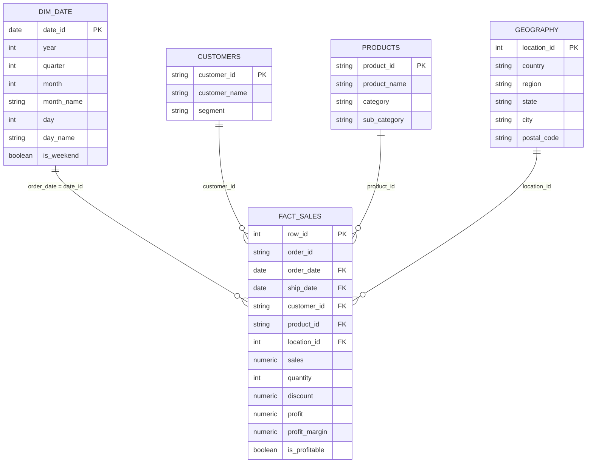

# Power BI / BI Dashboard Architecture & Data Modeling Guide

This document outlines how business intelligence analysts and BI developers (e.g., Power BI, Tableau, Metabase) should connect to and model the Superstore analytical warehouse.

---

## 1. Analytical Data Model (Star Schema)

The warehouse provides two consumption layers:
1. **Silver Dimensional Model**: Ideal for detailed drill-throughs, custom slicing, and row-level aggregations.
2. **Gold Aggregate Layer**: Optimized for high-speed executive dashboards, KPI cards, and trend visuals.

### Dimensional Entity Relationships (Silver Layer)



---

## 2. Table Classification & Role Mapping

| Schema | Table Name | Type | Key Columns | Primary Usage |
|---|---|---|---|---|
| `silver` | `fact_sales` | Fact | `row_id` (PK), `order_id`, foreign keys | Core transaction facts (9,994 line items) |
| `silver` | `customers` | Dimension | `customer_id` (PK) | Customer slicing, Segment filters |
| `silver` | `products` | Dimension | `product_id` (PK) | Category, Sub-Category, Item name |
| `silver` | `geography` | Dimension | `location_id` (PK) | Region, State, City, Zip map visuals |
| `silver` | `dim_date` | Dimension | `date_id` (PK) | Date hierarchy (Year > Quarter > Month > Day) |
| `gold` | `daily_sales` | Aggregated Fact | `order_date` (PK) | Daily time series and velocity charts |
| `gold` | `monthly_sales` | Aggregated Fact | `year`, `month` (Composite PK) | Year-over-Year (YoY) and monthly trend lines |
| `gold` | `category_performance` | Aggregated Summary | `category`, `sub_category` | Category matrix, loss order count |
| `gold` | `product_performance` | Dimension/Summary | `product_id` (PK) | Top 10 products and loss-makers table |
| `gold` | `customer_performance` | Dimension/Summary | `customer_id` (PK) | Customer LTV, ranking, purchase frequency |
| `gold` | `regional_performance` | Aggregated Summary | `region`, `state` (Composite PK) | State heatmaps and regional breakdown |
| `gold` | `kpi_summary` | Key-Value Metrics | `metric_name` (PK) | Executive banner cards |

---

## 3. Metrics Specification

### Pre-Calculated in Database (SQL Layer)
These metrics are materialized directly during pipeline execution for fast query performance:

- **Total Sales**: `SUM(sales)`
- **Total Profit**: `SUM(profit)`
- **Total Orders**: `COUNT(DISTINCT order_id)`
- **Total Quantity**: `SUM(quantity)`
- **Average Order Value (AOV)**: `SUM(sales) / COUNT(DISTINCT order_id)`
- **Line Profit Margin**: `profit / sales`
- **Overall Profit Margin %**: `(SUM(profit) / SUM(sales)) * 100` (12.47%)
- **Loss Orders Count**: `COUNT(CASE WHEN profit < 0 THEN 1 END)`
- **Loss-Making Products Flag**: `is_loss_maker = (total_profit < 0)` (299 products)
- **Product & Customer Ranks**: `DENSE_RANK() OVER (ORDER BY SUM(sales) DESC)`

### Recommended DAX Measures for Power BI
When using the Silver Star Schema with dynamic slicing, create these measures:

```dax
// 1. Dynamic Total Sales
Total Sales = SUM(fact_sales[sales])

// 2. Dynamic Total Profit
Total Profit = SUM(fact_sales[profit])

// 3. Dynamic Profit Margin %
Profit Margin % = 
DIVIDE([Total Profit], [Total Sales], 0)

// 4. Dynamic Order Count
Total Orders = DISTINCTCOUNT(fact_sales[order_id])

// 5. Dynamic Average Order Value (AOV)
AOV = 
DIVIDE([Total Sales], [Total Orders], 0)

// 6. Year-over-Year (YoY) Sales Growth %
YoY Sales Growth % = 
VAR CurrentSales = [Total Sales]
VAR PriorYearSales = CALCULATE([Total Sales], SAMEPERIODLASTYEAR(dim_date[date_id]))
RETURN
DIVIDE(CurrentSales - PriorYearSales, PriorYearSales, 0)
```

---

## 4. Recommended Power BI Dashboard Layout (5 Pages)

### Page 1: Executive Overview
- **Header KPI Cards**: Total Sales ($2.30M), Total Profit ($286.4K), Profit Margin (12.5%), Total Orders (5,009), Average Order Value ($458.61).
- **Line Chart**: Monthly Sales & Profit Trend (using `gold.monthly_sales`).
- **Donut Chart**: Sales distribution by Customer Segment (Consumer ~50%, Corporate ~30%, Home Office ~20%).
- **Map / Tree Map**: Sales by Region (West, East, Central, South).

### Page 2: Sales & Seasonality Analysis
- **Area Chart**: Cumulative Sales progression over time with Year slicer.
- **Bar Chart**: Sales and Profit by Shipping Mode (Standard Class, Second Class, First Class, Same Day).
- **Matrix / Heatmap**: Day-of-Week vs. Month sales intensity.

### Page 3: Product & Profitability Analysis
- **Scatter Plot**: Sales (X-axis) vs. Profit (Y-axis) per Sub-Category (identifies outliers like high sales with negative profit).
- **Table Visual**: Top 10 Products by Total Sales vs. Bottom 10 Products by Net Loss (filtered using `gold.product_performance[is_loss_maker] = TRUE`).
- **Bar Chart**: Profit Margin by Category (Technology ~17.4%, Office Supplies ~13.7%, Furniture ~2.5%).

### Page 4: Customer Segmentation & Lifetime Value
- **Scatter Plot**: Total Orders (X-axis) vs. Total Sales (Y-axis) per customer.
- **Top Customers Table**: Ranked by `gold.customer_performance[customer_rank]`.
- **Slicers**: Segment, Region, Date Range.

### Page 5: Regional & State Geographic Performance
- **Shape Map / Filled Map**: US State choropleth colored by `gold.regional_performance[total_profit]`.
- **Bar Chart**: Top 10 States by Sales vs. Top 10 States by Losses (e.g. Texas, Ohio, Pennsylvania show negative net profits due to aggressive discounting).
- **Filter Panel**: Region selector (South, West, Central, East).
